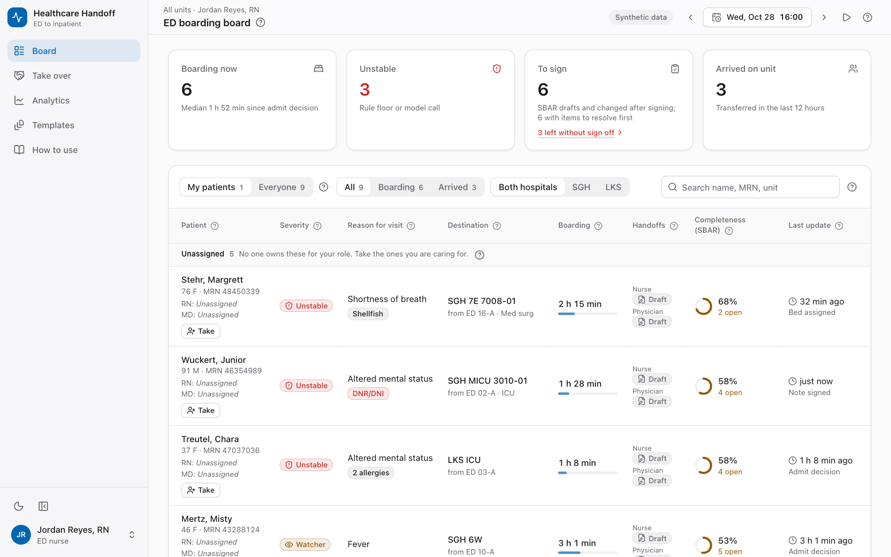
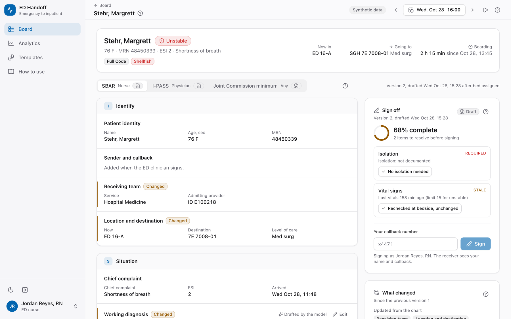
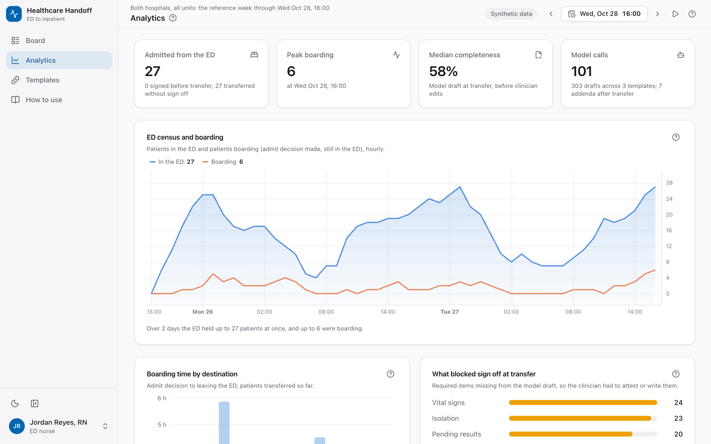
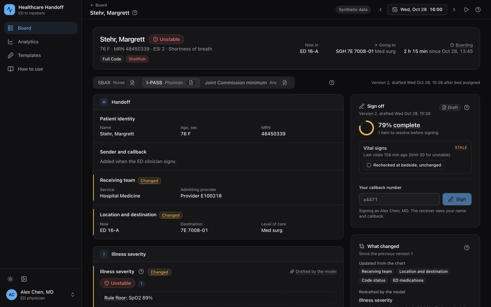
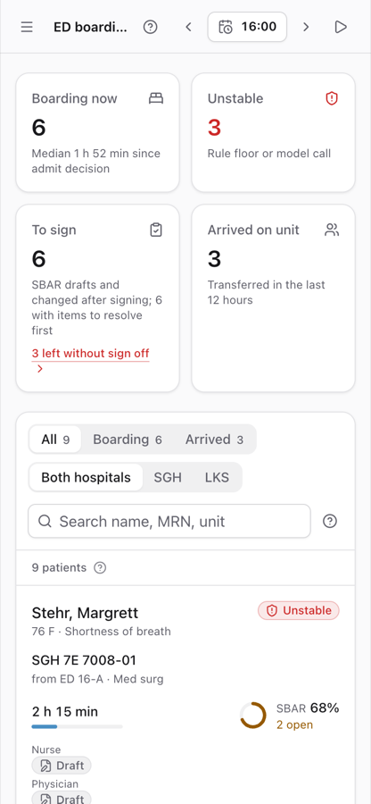

# ED to inpatient handoff (reference Databricks App)

When the emergency department decides to admit a patient, this app drafts the handoff from the chart, as an SBAR for nurses, an I-PASS for physicians and a short Joint Commission minimum. The ED clinician reviews, edits and signs it; the receiving unit accepts it with a read back. Every statement the model writes cites the chart record it came from. All data is synthetic.

**Live demo:** [d16hyap5wh4fcn.cloudfront.net](https://d16hyap5wh4fcn.cloudfront.net). It runs entirely in your browser on the reference week's real model drafts (no Databricks, nothing sent anywhere); switch roles in the menu at the bottom left, sign as the ED and accept as the unit. Changes reset on reload.



| A handoff, ready to review and sign | Analytics for the week |
| --- | --- |
|  |  |
|  |  |

## Deploy it

```bash
export DATABRICKS_CONFIG_PROFILE=<your profile>
scripts/deploy.sh dev
```

One bundle deploys the Lakebase database, the pipeline, the jobs and the app, then generates a synthetic week, drafts every handoff and starts the app (about two hours, about 2 USD). Step by step, requirements and settings: [docs/setup.md](docs/setup.md). AI agents: [AGENTS.md](AGENTS.md).

## Try it without Databricks

```bash
python -m venv .venv && .venv/bin/pip install -e ".[dev]"
cd synthetic && ../.venv/bin/python -m edip_synth --out out/world --synthea population/synthea_3000.json.gz && cd ..
for f in hl7 fhir clarity; do (cd synthetic && ../.venv/bin/python -m edip_synth.render.$f --truth out/world/truth --out out/world); done
.venv/bin/python app/fixtures/build.py
(cd app/client && npm ci && npm run build) && (cd app/server && ../../.venv/bin/uvicorn main:app --port 8000)
```

Open http://localhost:8000. Details: [app/README.md](app/README.md).

## How it works

```
Hospital feeds (synthetic): HL7 v2, Redox FHIR (batch or Zerobus), Clarity nightly tables
  -> bronze (Unity Catalog) -> Lakeflow pipeline: parse, reconcile across feeds, encounter state, triggers
  -> handoff job: chart packet, one model call per trigger, validator, completeness rules -> gold drafts
  -> Lakebase (synced drafts; the app's edits, attestations, sign offs and read backs)
  -> app: board, handoff review and sign off, read back, analytics, a guide for clinicians
```

| Folder | Read |
| --- | --- |
| `synthetic/` | [synthetic/README.md](synthetic/README.md): the generator, 32 logged edge cases, realism tests |
| `pipelines/` | [pipelines/README.md](pipelines/README.md): bronze to gold, deduplication, daylight saving time |
| `ai/` | [ai/README.md](ai/README.md): templates, prompt, validator, evaluation results, cost |
| `app/` | [app/README.md](app/README.md): pages, rules the server enforces, local runs |
| `docs/` | [setup.md](docs/setup.md), [zerobus.md](docs/zerobus.md) |

## Tests

`pytest -q` runs the generator, realism, renderer, parser, generation, evaluation and app API tests locally (no Databricks credentials). CI also typechecks, lints and builds the client.

## Data and licenses

Patients come from [Synthea](https://github.com/synthetichealth/synthea) (a 3,000 person population slice is committed in `synthetic/population/`); the ED visits, feeds and faults are generated on top. The hospitals (Shai General Hospital, Lakeside Community Hospital), people and identifiers are invented. Chart libraries: [TradingView Lightweight Charts](https://www.tradingview.com/lightweight-charts/) and Recharts (see `NOTICE`).

This project is licensed under the Apache License 2.0 (`LICENSE`).
