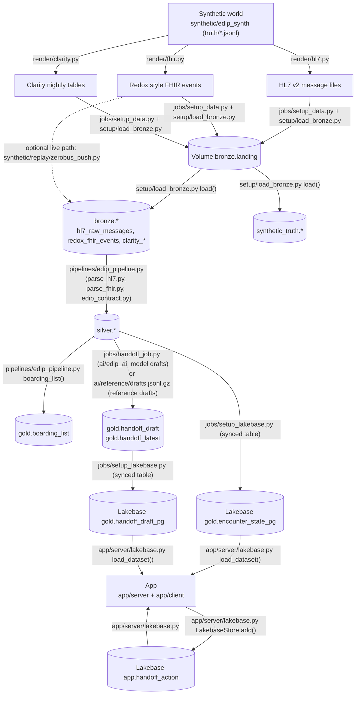

# Data model

How the data in this app is structured, how each table is made, and where to look to answer common questions. It is written for a data engineer or analyst who has cloned the repo, and for a clinical informaticist who wants to know where a handoff's facts come from. You do not need to read the code first.

All names below use the default catalog `edip`. If you deployed with `--var catalog=<catalog>`, replace `edip` with your catalog name. Row counts are from the reference week (the default synthetic population) after a full setup run.

## Contents

1. [The flow in one picture](#1-the-flow-in-one-picture)
2. [Unity Catalog tables](#2-unity-catalog-tables)
3. [Lakebase (Postgres)](#3-lakebase-postgres)
4. [Key concepts](#4-key-concepts)
5. [How it was made](#5-how-it-was-made)
6. [Where to look: questions and queries](#6-where-to-look-questions-and-queries)
7. [Notes: synthetic or real, real feeds, sizes](#7-notes)

## 1. The flow in one picture



In words: one synthetic week is generated once, then rendered three ways, the way a hospital really receives data. The setup job lands the renders in a volume and loads them into bronze. A Lakeflow pipeline parses both real time feeds into one schema in silver. The handoff job builds a chart packet for each generation point, writes drafts to gold, and Lakebase synced tables copy the encounter state and the drafts to Postgres. The app reads those two tables and writes every clinician action to its own table in Lakebase.

## 2. Unity Catalog tables

Each table lists what it holds, its grain (one row per what), the columns people join or filter on, what creates it and what reads it. "No code reads it" means the table is there for analysts and audits; the app and the jobs do not use it.

### Volume `bronze.landing`

Landing files for the synthetic feeds, written by `jobs/setup_data.py` (the `put()` function) through `setup/load_bronze.py load()`.

| Folder | Holds |
| --- | --- |
| `clarity/<snapshot date>/` | One JSONL file per Clarity table, one nightly snapshot (the latest, `2026-11-02`) |
| `hl7/hl7_messages.jsonl` | Every HL7 v2 message as one JSON line (path, message text, MSH fields, delivery time) |
| `fhir/fhir_events.jsonl` | Every Redox FHIR event with its envelope, when `fhir_mode=batch` (the default) |
| `truth/` | The generator's truth files (`*.jsonl`), plus `config.json` and `render_plan.json`, which stay as files |

### Schema `bronze`: raw feeds

| Table | What it holds | Grain | Key columns | Created by | Read by |
| --- | --- | --- | --- | --- | --- |
| `hl7_raw_messages` | Raw HL7 v2 messages, the landing shape of an interface engine (17,207 rows) | One row per delivered message, retransmits included | `path`, `msh_sending_facility`, `msh_control_id`, `msh_message_type`, `msh_trigger`, `engine_received_ts`, `content` | `setup/load_bronze.py load()` (CREATE OR REPLACE from the volume) | Pipeline view `hl7_parsed` |
| `redox_fhir_events` | Redox FHIR R4 events with the envelope; `bundle` is VARIANT (18,194 rows) | One row per delivered event, retries included | `event_id`, `event_type`, `facility_code`, `event_datetime`, `hl7_control_id`, `ingest_ts`, `bundle` | `setup/load_bronze.py` (`FHIR_DDL`, then a batch INSERT); or `synthetic/replay/zerobus_push.py` with `fhir_mode=zerobus` | Pipeline view `fhir_parsed` |
| `clarity_<table>` (65 tables) | Clarity style nightly snapshot with Epic EHI table and column names | One row per Clarity row (for example `clarity_pat_enc`: one per encounter in the snapshot) | Epic keys such as `PAT_ID`, `PAT_ENC_CSN_ID`, `ORDER_MED_ID`, `PROBLEM_LIST_ID` | `setup/load_bronze.py load()`, typed from `clarity/schema.json` | `clarity_patient`, `clarity_problem_list`, `clarity_order_med`, `clarity_allergy`: the pipeline's Clarity views; `clarity_patient` also by `jobs/handoff_job.py`. The other 61 tables: no code reads them |

<details>
<summary>All 65 Clarity tables with row counts</summary>

| Table | Rows | Table | Rows | Table | Rows |
| --- | ---: | --- | ---: | --- | ---: |
| clarity_allergy | 495 | clarity_hsp_admit_diag | 176 | clarity_problem_list | 2,831 |
| clarity_allergy_reactions | 495 | clarity_hsp_atnd_prov | 735 | clarity_rxnorm_codes | 180 |
| clarity_clarity_adt | 5,015 | clarity_identity_id | 1,358 | clarity_treatment_team | 1,803 |
| clarity_clarity_bed | 186 | clarity_infections | 18 | clarity_zc_acuity_level | 5 |
| clarity_clarity_component | 50 | clarity_ip_flo_gp_data | 12 | clarity_zc_adt_patient_stat | 5 |
| clarity_clarity_dep | 10 | clarity_ip_flwsht_meas | 27,671 | clarity_zc_code_status | 5 |
| clarity_clarity_eap | 38 | clarity_ip_flwsht_rec | 876 | clarity_zc_ed_disposition | 9 |
| clarity_clarity_edg | 103 | clarity_mar_admin_info | 1,801 | clarity_zc_ed_pat_status | 16 |
| clarity_clarity_emp | 81 | clarity_note_enc_info | 1,867 | clarity_zc_event_subtype | 3 |
| clarity_clarity_epm | 6 | clarity_ocs_code_status | 111 | clarity_zc_event_type | 10 |
| clarity_clarity_loc | 2 | clarity_order_med | 3,547 | clarity_zc_isolation | 4 |
| clarity_clarity_medication | 180 | clarity_order_medinfo | 806 | clarity_zc_lab_status | 4 |
| clarity_clarity_rom | 154 | clarity_order_proc | 1,895 | clarity_zc_level_of_care | 5 |
| clarity_clarity_ser | 81 | clarity_order_results | 6,908 | clarity_zc_mar_rslt | 9 |
| clarity_clarity_ser_spec | 81 | clarity_patient | 679 | clarity_zc_note_status | 6 |
| clarity_ed_dispo_audit | 602 | clarity_patient_race | 679 | clarity_zc_order_status | 9 |
| clarity_ed_iev_event_info | 4,721 | clarity_pat_allergies | 495 | clarity_zc_pat_class | 4 |
| clarity_ed_iev_pat_info | 638 | clarity_pat_enc | 640 | clarity_zc_pend_req_status | 4 |
| clarity_ed_pat_status | 4,721 | clarity_pat_enc_dx | 691 | clarity_zc_result_flag | 7 |
| clarity_hno_info | 1,867 | clarity_pat_enc_hsp | 640 | clarity_zc_result_status | 4 |
| clarity_hno_note_text | 8,634 | clarity_pat_enc_hsp_2 | 640 | | |
| clarity_hsp_account | 640 | clarity_pat_enc_rsn_visit | 638 | | |
| clarity_pend_action | 117 | | | | |

The snapshot is the night of 2026-11-02, so encounters that arrived after that night (the last afternoon of the week) are in the real time feeds but not yet in Clarity: 640 encounters in `clarity_pat_enc` against 702 in silver.

</details>

### Schema `silver`: parsed and reconciled feeds

All silver tables are datasets of `pipelines/edip_pipeline.py` (the function of the same name). Both real time feeds are parsed into the records defined in `pipelines/edip_contract.py`, so every feed table has the same columns whatever the source; `source` says `hl7` or `fhir`. Every feed table also has `landed_ts` (when the message reached bronze) and `processed_ts` (when the pipeline handled it), for freshness.

| Table | What it holds | Grain | Key columns | Read by |
| --- | --- | --- | --- | --- |
| `adt_events` (streaming) | ADT events from both feeds in one vocabulary (`ADT_KINDS`) | One row per ADT message per feed, after dropping retransmits on (`source`, `msg_key`). An event sent on both feeds appears twice, once per `source` | `csn`, `kind`, `effective_ts`, `recorded_ts`, `source`, `msg_key`, `unit`, `pending_unit` | `encounter_changes` view (feeds `encounter_state`, `adt_history`), `handoff_events`, `jobs/handoff_job.py` |
| `observations` (streaming) | Labs, imaging, ECG and vitals (`category`) | One row per result component (or vital value) per status, deduplicated across feeds | `csn`, `category`, `order_id`, `code`, `status`, `observed_ts`, `resulted_ts`, `flag` (`HH`, `LL` are critical), `validated` | `handoff_events` (critical results), `jobs/handoff_job.py` |
| `med_events` (streaming) | Medication orders and administrations | One row per order (`event = 'order'`) or administration line (`event = 'administration'`) | `csn`, `order_id`, `event`, `line`, `action`, `event_ts`, `rxcui` | `jobs/handoff_job.py` |
| `notes` (streaming) | Clinical notes with full text | One row per note version (`status` In Progress or Signed) | `csn`, `note_id`, `note_type`, `status`, `signed_ts` | `handoff_events` (signed notes), `jobs/handoff_job.py` |
| `allergy_events` (streaming) | Allergies sent on the real time feeds | One row per allergy report | `mrn`, `allergen`, `recorded_ts` | `jobs/handoff_job.py` |
| `flag_events` (streaming) | Isolation and code status values | One row per value change per kind | `csn`, `kind` (`isolation`, `code_status`), `value`, `recorded_ts` | `jobs/handoff_job.py` |
| `quarantine` (streaming) | Messages that could not be applied, with a reason (6 rows: the planted empty visit messages, 3 per feed) | One row per message | `source`, `facility`, `msg_key`, `reason` | No code reads it |
| `encounter_state` (streaming, AUTO CDC SCD1) | Current state of each encounter: status, location, pending bed, class, ESI, key times | One row per encounter (`csn`) | `csn`, `facility`, `mrn`, `status` (`in_ed`, `boarding`, `inpatient`, `discharged`, `canceled`), `unit`, `pending_unit`, `arrival_ts`, `admit_decision_ts`, `ed_departure_ts` | `gold.boarding_list`, the Lakebase synced table `gold.encounter_state_pg`, so the app |
| `adt_history` (streaming, AUTO CDC SCD2) | Status and location history | One row per period in which `status`, `patient_class`, `unit`, `room`, `bed` or `pending_unit` stayed the same | `csn`, `__START_AT`, `__END_AT` (structs of `last_event_ts`, `recorded_ts`; open period has `__END_AT` null) | No code reads it |
| `handoff_events` (streaming) | Deterministic triggers for the handoff generator | One row per trigger, deduplicated across feeds | `csn`, `action` (`start`, `regenerate`, `finalize`, `retract`), `kind` (ADT kind, `critical_result` or `note_signed`), `effective_ts`, `reason` | `jobs/handoff_job.py`; also the table update trigger of the paused live job in `databricks.yml` |
| `problem_list` (materialized view) | Active problems from Clarity, with the MRN | One row per Clarity problem list entry | `PAT_ID`, `mrn`, `PROBLEM_LIST_ID`, `DESCRIPTION` | `jobs/handoff_job.py` |
| `home_meds` (materialized view) | Outpatient medications from Clarity (`ORDERING_MODE_C_NAME = 'Outpatient'`) | One row per outpatient order | `PAT_ID`, `mrn`, `ORDER_MED_ID`, `DESCRIPTION` | `jobs/handoff_job.py` |
| `allergy_history` (materialized view) | Allergies from Clarity | One row per Clarity allergy | `PAT_ID`, `mrn`, `ALLERGY_ID`, `ALLERGEN_ID_ALLERGEN_NAME` | No code reads it (the handoff uses `allergy_events`) |

The silver schema also holds `event_log_<id>` and `__materialization_*` tables. The pipeline manages them; ignore them.

### Schema `gold`: handoffs and app facing tables

| Table | What it holds | Grain | Key columns | Created by | Read by |
| --- | --- | --- | --- | --- | --- |
| `handoff_draft` (Delta, change data feed on) | Every generated handoff version, with the draft JSON, validation and token counts (1,320 rows) | One row per encounter, template and version (`csn`, `template`, `version`) | `csn`, `template`, `version`, `status`, `trigger`, `as_of`, `severity`, `score`, `blocking`, `draft`, `validation`, `model`, `prompt_tokens`, `completion_tokens` | `jobs/handoff_job.py main()` (CREATE TABLE, then `flush()` per batch; `load_reference()` for reference drafts) | Lakebase sync `gold.handoff_draft_pg`, `handoff_latest` (MERGE), `ai/eval/export_drafts.py` |
| `handoff_latest` (Delta, primary key `csn`, `template`) | Newest version per encounter and template (354 rows) | One row per encounter and template | same as above, without `validation` and tokens | `jobs/handoff_job.py main()` (MERGE at the end of each run) | No code reads it; handy for analysts |
| `boarding_list` (materialized view) | Encounters in the ED or boarding now (24 rows at the end of the week) | One row per encounter with status `in_ed` or `boarding` | `csn`, `facility`, `status`, `pending_unit`, `admit_decision_ts` | `pipelines/edip_pipeline.py boarding_list()` | No code reads it (the app builds its board from `encounter_state_pg`) |
| `encounter_state_pg`, `handoff_draft_pg` (type FOREIGN) | The Unity Catalog entries of the two Lakebase synced tables (section 3) | as in Lakebase | as in Lakebase | `jobs/setup_lakebase.py` | Query them in Postgres |

The gold schema also holds `__<id>_databricks_postgres_gold_*_pg_<id>` and `event_log_<id>` tables: storage and logs of the synced table pipelines (`new_pipeline_spec` in `jobs/setup_lakebase.py`). Ignore them.

### Schema `synthetic_truth`: what really happened, for evaluation

Loaded by `setup/load_bronze.py load()` with `read_files` on `truth/*.jsonl` (schema inferred, so every table has a `_rescued_data` column and times are ISO strings in facility time with an offset). No code reads these tables: the evaluation (`ai/eval/run_eval.py`) and the tests read the same truth from the JSONL files. They are here so you can check any silver or gold row against the truth in SQL. A real hospital has no such schema.

| Table | What it holds | Grain | Key columns | Rows |
| --- | --- | --- | --- | ---: |
| `patients` | Synthetic patients (Synthea history plus identity) | One per patient | `pat_id`, `mrn`, `merged_into` | 679 |
| `encounters` | Each ED visit with its scenario and key times | One per encounter | `csn`, `pat_id`, `facility`, `scenario`, `arrival_at`, `decision_at`, `departure_at`, `disposition`, `unit`, `state_at_end` | 702 |
| `adt` | True ADT events | One per event | `event_id`, `csn`, `kind`, `effective_at`, `recorded_at`, `seq` | 4,663 |
| `ed_events` | ED tracking board events | One per event | `csn`, `name`, `event_at`, `adt_event_id` | 5,152 |
| `bed_requests` | Bed requests and assignments | One per request | `pend_id`, `csn`, `requested_at`, `assigned_at`, `deleted` | 124 |
| `census` | Unit census over the week | One per unit and time | `facility`, `unit`, `at`, `occupied`, `boarders` | 1,690 |
| `vitals` | Vital sets | One per set | `csn`, `taken_at`, `line`, `validated` | 3,755 |
| `orders` | Lab and imaging orders | One per order | `order_id`, `csn`, `code`, `ordered_at` | 1,990 |
| `results` | Result components | One per component and status | `order_id`, `csn`, `lab`, `status`, `resulted_at`, `flag` | 7,893 |
| `med_orders` | Medication orders | One per order | `order_med_id`, `csn`, `rxcui` | 878 |
| `mar` | Medication administrations | One per administration | `order_med_id`, `line`, `action`, `taken_at` | 2,007 |
| `notes` | Notes with their versions | One per note | `note_id`, `csn`, `note_type`, `signed_at`, `versions` | 2,049 |
| `allergies` | Allergies | One per patient allergy | `allergy_id`, `pat_id`, `allergen`, `added_csn` | 495 |
| `code_status` | Code status orders | One per order | `ocs_id`, `csn`, `status`, `activated_at` | 117 |
| `infections` | Infections and isolation | One per infection | `infection_id`, `csn`, `isolation`, `added_at` | 18 |
| `departments` | EDs and inpatient units | One per department | `dept_id`, `facility`, `code`, `level`, `beds` | 10 |
| `facilities` | The two hospitals | One per facility | `code` | 2 |
| `providers` | Clinicians | One per provider | `prov_id`, `user_id`, `prov_type` | 81 |
| `fault_manifest` | Every injected fault that changes what happened, with what the app should do | One per fault instance | `fault_id`, `csn`, `stream`, `event_time`, `description`, `expected` | 279 |

## 3. Lakebase (Postgres)

Lakebase project `edip` (bundle variable `lakebase_project`), branch `production`, database `databricks_postgres`. The bundle creates the project; `jobs/setup_lakebase.py` creates the synced tables; the app creates its own schema.

### Synced tables (schema `gold`, read only copies)

| Postgres table | Source in Unity Catalog | Primary key | Sync mode | Rows |
| --- | --- | --- | --- | ---: |
| `gold.encounter_state_pg` | `silver.encounter_state` | `csn` | Triggered | 702 |
| `gold.handoff_draft_pg` | `gold.handoff_draft` | `csn`, `template`, `version` | Triggered | 1,320 |

- Columns are the source columns with Postgres types: timestamps are `timestamptz`, `draft` and `validation` are `text` (JSON), and `blocking` is `jsonb` (a JSON array of rule ids).
- **Triggered** means a sync runs only when someone starts it, and then copies only the changes, read from the source's change data feed.
- **Who refreshes them, and when:**
  - `jobs/setup_lakebase.py` (the `lakebase` task of `edip_setup`) creates them on the first setup and waits for the first sync; on later setups it runs a full refresh, because setup fully refreshes the sources.
  - `jobs/handoff_job.py refresh_synced()` starts a refresh of both at the end of every handoff run. It does not wait.
  - A pipeline run alone does not refresh `encounter_state_pg`. In live mode, the next handoff run carries the new state to Lakebase.
- The app reads both tables in full and reloads them at most once a minute (`app/server/lakebase.py load_dataset()`).
- With the live clock (`EDIP_CLOCK_MODE=live`), a version in `handoff_draft_pg` shows in the app from its `created_ts` (when the handoff job wrote it) or its `as_of`, whichever is later, so a look at an earlier time shows the drafts as they were then (a few minutes early: the sync and the app's reload come after `created_ts`). Encounter details and the `retracted` status, which the handoff job sets on every version in place, are as they are now. The replay clock uses `as_of` only.

### App schema `app`: `app.handoff_action`

The app's action log. The app creates it on first start (`DDL` in `app/server/lakebase.py`) and writes it in `LakebaseStore.add()`. It is **append only**: nothing is updated or deleted, so the table is its own audit trail. A Restore is a new `edit` row, not an undo.

| Column | Type | Meaning |
| --- | --- | --- |
| `action_id` | bigint, identity, primary key | Order of insertion |
| `csn` | text | Encounter |
| `template` | text | `sbar_nurse`, `ipass_physician` or `custom_sea58` |
| `version` | integer | The draft version the clinician was looking at; joins to `gold.handoff_draft_pg (csn, template, version)` |
| `kind` | text, check | `edit` (changed a narrative element's text or items), `attest` (picked an option from a rule's fixed list), `sign` (the sending ED clinician signed), `ack` (the receiving clinician accepted with a read back) |
| `at` | timestamptz | The time the action applies to: the replay clock time with `EDIP_CLOCK_MODE=replay` (the default for the synthetic week), the current time with `live`. A view at time T counts only actions with `at <= T` |
| `recorded_ts` | timestamptz, default `now()` | When the row was saved |
| `by_name` | text | Display name of the persona or user who acted |
| `role` | text | `ed_nurse`, `ed_physician`, `admitting_physician`, `unit_nurse` (see `app/server/personas.py`) |
| `user_email` | text, nullable | The signed in Databricks user, from the forwarded headers |
| `detail` | jsonb | What the action carried. Keys by kind: `edit`: `element`, `text` or `items`, `model_before`, `restore`; `attest`: `rule`, `option`, and `entry` and `entry_note` for options that ask for a typed value (for example the allergen and its reaction); `sign`: `callback`; `ack`: `readback`, `questions`. The allowed keys are `DETAIL` in `app/server/lakebase.py` |

Index: `ix_action_csn (csn, at)`.

### App schema `app`: `app.view_log`

Who looked at an earlier time, with the live clock (`EDIP_PAST_VIEW_HOURS`, `app/README.md`). The app creates it with `app.handoff_action` (`DDL` in `app/server/lakebase.py`) and writes one row in `LakebaseStore.log_view()` before it answers each read of the board, a handoff or analytics at an earlier time. If the row cannot be written, the app refuses the view. Reads at the current time, and the replay clock, write nothing. Append only.

| Column | Type | Meaning |
| --- | --- | --- |
| `view_id` | bigint, identity, primary key | Order of insertion |
| `page` | text, check | `board`, `handoff` or `analytics` |
| `csn` | text, nullable | The patient, for `handoff` |
| `at` | timestamptz | The earlier time viewed |
| `recorded_ts` | timestamptz, default `now()` | When it was viewed |
| `by_name` | text | Display name of the signed in user (or persona) |
| `role` | text | As in `app.handoff_action`; `viewer` for read only users |
| `user_email` | text, nullable | The signed in Databricks user, from the forwarded headers |

Index: `ix_view_recorded (recorded_ts)`.

### Who can read and write what

| Identity | `gold.encounter_state_pg`, `gold.handoff_draft_pg` | `app.handoff_action`, `app.view_log` |
| --- | --- | --- |
| The identity that ran setup (a user or a service principal) | Owns the synced tables and schema `gold` | No grant from the repo |
| The app's service principal | `USAGE` on schema `gold` and `SELECT` on all its tables, granted by `jobs/setup_lakebase.py` | Owns schema `app` and its tables: it creates them on first start, through the app's `postgres` resource with `CAN_CONNECT_AND_CREATE` (`databricks.yml`) |
| `databricks_superuser` (Lakebase built in role) | All privileges | All privileges |

The grant covers the tables that exist when setup runs. If a synced table is recreated, run the `lakebase` task again so the app can read it.

## 4. Key concepts

### CSN and encounter

The **CSN** (contact serial number, Epic's encounter id) identifies one ED visit. It is `csn` in every silver, gold and Lakebase table, `PV1-19` in HL7 and the visit number identifier in FHIR. One patient (`mrn`) can have several CSNs, for example a return visit within 72 hours. After a patient merge, `silver.encounter_state.mrn` holds the surviving MRN while `silver.adt_events.mrn` keeps the MRN each message carried.

### Generation point and versions

A **generation point** is one moment (`as_of`) at which the handoff job built a chart packet for one encounter and called the model once. The points per encounter come from `silver.handoff_events` through `ai/edip_ai/points.py select_points()`:

- the start (admit decision, `pending_admit`);
- regenerate triggers (bed assigned or unassigned, class change, a signed note, a critical result), at least 60 minutes apart when backfilling a past week;
- the transfer to the unit (status `final`);
- after the transfer, only ED addenda: a late signed ED note or a critical result collected in the ED (status `addendum`).

Each point writes one row per template, so the reference week has 440 points and 1,320 drafts for 118 admitted encounters. `version` counts 1, 2, 3 per encounter and template in `as_of` order. `trigger` holds the `kind` of the trigger that made the point. `status` is `draft`, `final`, `addendum` or `retracted` (a canceled registration marks earlier drafts retracted). The three rows of one point share the same token counts, because they come from one model call.

### Templates and elements

`ai/templates/elements.yaml` defines 31 canonical elements, `E01` to `E31` (for example `E01` patient identity, `E07` illness severity, `E09` allergies, `E14` vital signs, `E16` pending results, `E24` action list). Each has a kind:

- `deterministic`: rendered straight from chart data, never by the model;
- `narrative`: written by the model, each statement citing source ids;
- `process`: completed in the app (sender and callback, read back).

Three templates place the elements into their own sections and set one rule per element:

| Template id | For | Sections | Rule ids |
| --- | --- | --- | --- |
| `sbar_nurse` | Nurse to nurse | I, S, B, A, R, RB | `N01` to `N21` |
| `ipass_physician` | Physician to physician | HDR, I, P, A, S1, S2 | `P01` to `P16` |
| `custom_sea58` | Any (Joint Commission minimum) | ID, SEV, SUM, SAFE, MED, DATA, TODO, RB | `C01` to `C12` |

A rule's level is `hard` (blocks sign off until it has data or an attestation), `stale` (blocks when the data is older than the limit for the patient's severity) or `soft` (warns and counts in the score).

### The draft JSON

`gold.handoff_draft.draft` is one JSON document per row. Top level keys:

| Key | Holds |
| --- | --- |
| `template`, `name`, `audience` | Which template this is |
| `as_of` | The generation point, in facility time with an offset |
| `severity` | `stable`, `watcher` or `unstable`: the higher of the rule floor (`ai/edip_ai/severity.py`) and the model's call |
| `sections` | The template's sections in order; each has `id`, `label` and `elements`. Each element has `id` (E01...), `label`, `kind`, its content (`data` for deterministic elements, `narrative` for model elements) and the `rules` that apply to it |
| `rules` | Every rule result for the template: `rule`, `element`, `level`, `label`, `status` (`pass`, `missing`, `stale`, `attest`, `deferred` for checks done in the app), `evidence` (source ids), `message` |
| `completeness` | `score` (share of judged rules that pass) and `blocking` (hard or stale rules not passing). Same values as the `score` and `blocking` columns |
| `evidence` | Every chart record the draft may cite, keyed by source id, with the values shown in the app |
| `trend` | `vitals` (one entry per vital set) and `labs` (series per lab name), for the trend charts |

A narrative element's `narrative` holds `text` (or `items` for the action list, each with `owner`, `due` and its own `sources`), `sources` (the source ids it cites), `confidence`, and the validator's `unsupported_numbers` and `weakly_supported_numbers`. For illness severity it also holds `value`, the model's own call in `model_value`, and the rule `floor` with its reasons.

The `validation` column is separate JSON with counts for the whole model call: `unknown_sources` (cited ids not in the packet, removed), `unsupported_numbers` (numbers not found in the cited sources, highlighted for the clinician), `uncited_statements` and `issues`.

A trimmed real example (reference week, CSN 40011200123, `custom_sea58`, version 1):

```json
{
  "template": "custom_sea58",
  "name": "Custom handoff (Joint Commission minimum)",
  "audience": "any",
  "as_of": "2026-10-26T19:29:04-04:00",
  "severity": "watcher",
  "sections": [
    {"id": "SEV", "label": "Illness assessment", "elements": [
      {"id": "E07", "label": "Illness severity", "kind": "narrative",
       "narrative": {
         "value": "watcher",
         "text": "Watcher by rule: ESI 2; preliminary result pending. Vitals stable (HR 97, BP 129/81, RR 18, SpO2 97% RA) ...",
         "sources": ["enc:visit", "obs:700120757:CTAP:P", "vital:2026-10-26T19:05:22-04:00"],
         "confidence": 1.0, "unsupported_numbers": [], "weakly_supported_numbers": [],
         "model_value": "stable",
         "floor": {"value": "watcher", "reasons": ["ESI 2", "preliminary result pending"]}},
       "rules": [{"rule": "C03", "level": "hard", "status": "pass", "...": "..."}]}]},
    {"id": "SAFE", "label": "Allergies and code status", "elements": [
      {"id": "E09", "label": "Allergies", "kind": "deterministic",
       "data": [{"allergen": "Cephalexin", "reaction": "Hives", "severity": "Low", "src": "allergy:1"}],
       "rules": [{"rule": "C07", "level": "hard", "status": "pass", "evidence": ["allergy:1"]}]}]}
  ],
  "rules": [
    {"rule": "C02", "element": "E02", "level": "hard", "label": "Sender and callback", "status": "deferred",
     "message": "Checked at sign in the app"},
    {"rule": "C08", "element": "E08", "level": "hard", "label": "Code status", "status": "attest",
     "message": "Code status: not documented"}
  ],
  "completeness": {"score": 0.9, "blocking": ["C08"]},
  "evidence": {
    "obs:700120757:CTAP:P": {"name": "Impression", "value": "Preliminary: Distended gallbladder with wall thickening.",
                             "status": "P", "resulted_ts": "2026-10-26T17:02:40-04:00"},
    "med:700120765:1": {"name": "morphine 4 mg/mL injection", "dose": "4", "unit": "mg", "route": "IV", "action": "Given"},
    "note:900330947": {"type": "ED Provider Notes", "status": "Signed", "text": "HPI: ..."}
  },
  "trend": {"vitals": [{"hr": 98.0, "bp": "134/85", "spo2": 100.0, "taken_ts": "2026-10-26T15:05:22-04:00"}],
            "labs": {"Lipase": [{"ts": "2026-10-26T16:13:07-04:00", "value": 1946.0, "units": "U/L", "flag": "H"}]}}
}
```

Its `validation` column: `{"unknown_sources": 1, "unsupported_numbers": 0, "uncited_statements": 1, "issues": []}`.

### Source ids and how they map back to silver

Every fact in the chart packet carries a source id (`ai/edip_ai/chart.py`). The model must cite them; the validator drops ids that are not in the packet. To go from a cited id to the row it came from:

| Source id | Comes from | Match on |
| --- | --- | --- |
| `obs:<order_id>:<code>:<status>` | `silver.observations` (labs, imaging, ECG) | `order_id`, `coalesce(code, loinc)`, `status` (the latest row of that status) |
| `vital:<time>` | `silver.observations` with `category = 'vital'` | `observed_ts` equal to the time in the id (the id is in facility time; the column is UTC) |
| `med:<order_id>:<line>` | `silver.med_events` (administrations) | `order_id`, `line` |
| `note:<note_id>` | `silver.notes` | `note_id` (the latest version as of the point) |
| `flag:code_status`, `flag:isolation` | `silver.flag_events` (latest of that kind), else `silver.encounter_state` | `csn`, `kind` |
| `allergy:<n>` | `silver.allergy_events` | Position only: the n-th distinct allergen in recorded order, not a key. Use the allergen name in `evidence` |
| `problem:<PROBLEM_LIST_ID>` | `silver.problem_list` | `PROBLEM_LIST_ID` |
| `homemed:<ORDER_MED_ID>` | `silver.home_meds` | `ORDER_MED_ID` |
| `enc:identity`, `enc:visit`, `enc:destination` | Encounter state folded from `silver.adt_events` up to `as_of` | `csn` |
| `patient:social` | `bronze.clarity_patient` (language) | `PAT_ID` |

From a silver row you can go one step further back: `msg_key` is `MSH-3|MSH-4|MSH-10` for HL7 (`bronze.hl7_raw_messages`) and the Redox log id (`event_id` in `bronze.redox_fhir_events`) for FHIR. Query 12 below shows the join.

### Synthetic truth and the fault manifest

The generator knows what really happened, so the `synthetic_truth` tables let you score every step: did the pipeline get the right status, did the draft list the right allergies, did it miss a critical result. `ai/eval/run_eval.py` does this scoring from the truth files.

`fault_manifest` lists the faults that change what happened, one row per instance: `F07` late transfers, `F09` wrong patient registrations, `F12` merges, `F16` notes signed after departure, `F17` critical results near departure, `F18` pending results at departure, `F20` missing code status, `F21` new allergies, `F22` isolation found after the bed request, `F29` 72 hour returns and others. `expected` says what the app should do about each one. Faults that only change how a feed looks (A08 floods, retransmits, out of order delivery, time offsets, Z segments) are chosen in `render_plan.json` in the volume, not in this table.

### Time zones

- **Tables store UTC.** Delta `TIMESTAMP` columns are UTC (the handoff job pins the Spark session to UTC), and Lakebase columns are `timestamptz`.
- **The draft JSON uses facility time with an offset**, for example `2026-10-26T19:29:04-04:00`, including inside `vital:` source ids.
- **The app shows facility time**, from `EDIP_TIMEZONE` (default `America/New_York`).
- **`synthetic_truth` times are ISO strings in facility time with an offset.**
- The reference week includes the end of daylight saving time (2026-11-01, 01:00 happens twice). The HL7 parser resolves the repeated hour against the engine receipt time; see `pipelines/README.md`.

## 5. How it was made

In the order the setup runs:

1. **Generator** ([synthetic/README.md](../synthetic/README.md), `synthetic/edip_synth`): one week (2026-10-26 15:00 to 2026-11-02 15:00, America/New_York) at two hospitals, 702 encounters on a committed Synthea population (`synthetic/population/synthea_3000.json.gz`), written as `truth/*.jsonl` plus `fault_manifest.jsonl` and `render_plan.json`. Deterministic for a given seed and population.
2. **Renderers** (`synthetic/edip_synth/render/hl7.py`, `fhir.py`, `clarity.py`): the same truth as HL7 v2 files per interface, Redox style FHIR events and nightly Clarity snapshots.
3. **Setup job** `edip_setup` (`databricks.yml`), four tasks:
   - `data` (`jobs/setup_data.py`): creates the catalog if needed and the four schemas, runs the generator and renderers on the job's disk, writes the volume, loads bronze and `synthetic_truth` (`setup/load_bronze.py`), and clears old drafts.
   - `pipeline`: a full refresh of `edip-pipeline-<target>` ([pipelines/README.md](../pipelines/README.md)).
   - `handoffs`: runs the `handoff_generator` job (`jobs/handoff_job.py`, [ai/README.md](../ai/README.md)) with `drafts=reference` by default.
   - `lakebase` (`jobs/setup_lakebase.py`): synced tables and the app's read grant.
4. **Reference drafts** ([ai/reference/README.md](../ai/reference/README.md)): `ai/reference/drafts.jsonl.gz` holds the 1,320 drafts `databricks-gpt-oss-120b` wrote for the reference week. The job loads them only when every generation point and the templates fingerprint (`meta.json`) match; otherwise it calls the model for everything (`--var drafts=model` always does).
5. **App** ([app/README.md](../app/README.md)): FastAPI server (`app/server`) and React client (`app/client`), deployed as a Databricks App by the bundle (`databricks bundle run edip_app`). It reads the synced tables and writes `app.handoff_action`. Mock mode and the static demo use fixtures built by `app/fixtures/build.py` instead of Lakebase.

## 6. Where to look: questions and queries

Every query below was run against the reference deployment and returned rows. Queries 1 to 12 run in a Databricks SQL editor (catalog `edip`); 13 to 15 run in Postgres (the Lakebase SQL editor, or `psql` with a database credential). The example CSNs are from the reference week: 40011200326 is an observation patient with several draft versions and four planted faults; 40011200304 has signed and acknowledged actions on the reference deployment. Actions only exist where someone used the app, so pick a CSN from `app.handoff_action` on yours.

| # | Question | Table |
| --- | --- | --- |
| 1 | Every event for one encounter | `silver.adt_events`, `observations`, `med_events`, `notes` |
| 2 | Latest vitals of each boarding patient | `silver.observations`, `silver.encounter_state` |
| 3 | Every draft version of an encounter and what triggered it | `gold.handoff_draft` |
| 4 | Which chart records a draft cited | `gold.handoff_draft` (`draft:evidence`) |
| 5 | The silver rows behind a draft's lab citations | `gold.handoff_draft`, `silver.observations` |
| 6 | Which drafts the validator flagged | `gold.handoff_draft` (`validation`) |
| 7 | Boarding time per receiving unit | `silver.encounter_state` |
| 8 | Bed and status history of an encounter | `silver.adt_history` |
| 9 | What still blocks sign off on the newest drafts | `gold.handoff_latest` |
| 10 | Faults injected for an encounter | `synthetic_truth.fault_manifest` |
| 11 | Model tokens and cost | `gold.handoff_draft` |
| 12 | The raw message behind a silver row | `silver.adt_events`, `bronze.hl7_raw_messages`, `bronze.redox_fhir_events` |
| 13 | Every clinician action on a handoff | Lakebase `app.handoff_action` |
| 14 | Who signed what and when | Lakebase `app.handoff_action`, `gold.handoff_draft_pg` |
| 15 | Which patients transferred without sign off | Lakebase `gold.encounter_state_pg`, `gold.handoff_draft_pg`, `app.handoff_action` |

**1. Every event for one encounter, in time order.** ADT events appear once per feed (`source`), because the same event arrives on HL7 and FHIR.

```sql
SELECT effective_ts AS at_utc, 'adt' AS feed, kind AS what, concat_ws(' ', unit, room, bed) AS detail, source
FROM edip.silver.adt_events WHERE csn = '40011200326'
UNION ALL
SELECT resulted_ts, category, name, concat_ws(' ', value, units, flag, status), source
FROM edip.silver.observations WHERE csn = '40011200326' AND category <> 'vital'
UNION ALL
SELECT event_ts, 'med', name, concat_ws(' ', event, action, dose, unit, route), source
FROM edip.silver.med_events WHERE csn = '40011200326'
UNION ALL
SELECT coalesce(signed_ts, created_ts), 'note', note_type, status, source
FROM edip.silver.notes WHERE csn = '40011200326'
ORDER BY at_utc
```

**2. Latest vital signs of each patient boarding now.** Device values not yet validated by a nurse are left out, as the handoff does.

```sql
WITH v AS (
  SELECT o.csn, o.observed_ts, o.code, coalesce(cast(o.numeric AS STRING), o.value) AS val,
         max(o.observed_ts) OVER (PARTITION BY o.csn) AS latest
  FROM edip.silver.observations o
  JOIN edip.silver.encounter_state e ON e.csn = o.csn AND e.status = 'boarding'
  WHERE o.category = 'vital' AND o.validated IS NOT false)
SELECT csn, observed_ts, map_from_entries(collect_list(struct(code, val))) AS vitals
FROM v WHERE observed_ts = latest GROUP BY csn, observed_ts
```

**3. Every draft version of one encounter and what triggered it.**

```sql
SELECT template, version, status, trigger, as_of, severity, score, blocking
FROM edip.gold.handoff_draft
WHERE csn = '40011200326'
ORDER BY template, version
```

**4. Which chart records one draft cited.** The `evidence` map holds every record the draft may cite; the cited ids of each element are in its `narrative.sources` and rule `evidence`.

```sql
SELECT e.key AS source_id, split(e.key, ':')[0] AS record_type, e.value AS cited
FROM edip.gold.handoff_draft d,
     LATERAL variant_explode(parse_json(d.draft):evidence) e
WHERE d.csn = '40011200326' AND d.template = 'sbar_nurse' AND d.version = 1
ORDER BY source_id
```

**5. The silver rows behind a draft's lab and imaging citations** (the `obs:` mapping from section 4).

```sql
WITH cited AS (
  SELECT DISTINCT e.key AS source_id
  FROM edip.gold.handoff_draft d, LATERAL variant_explode(parse_json(d.draft):evidence) e
  WHERE d.csn = '40011200326' AND d.template = 'sbar_nurse' AND d.version = 1 AND e.key LIKE 'obs:%')
SELECT c.source_id, o.name, o.value, o.units, o.flag, o.status, o.resulted_ts, o.source, o.msg_key
FROM cited c
JOIN edip.silver.observations o
  ON o.csn = '40011200326'
 AND o.order_id = split(c.source_id, ':')[1]
 AND coalesce(o.code, o.loinc) = split(c.source_id, ':')[2]
 AND o.status = split(c.source_id, ':')[3]
ORDER BY o.resulted_ts
```

**6. Drafts the validator flagged** for numbers it could not find in the cited sources. On the reference week these are mostly fluid totals the model summed across boluses.

```sql
SELECT csn, template, version, as_of,
       get_json_object(validation, '$.unsupported_numbers') AS unsupported_numbers,
       get_json_object(validation, '$.unknown_sources') AS unknown_sources_removed,
       get_json_object(validation, '$.uncited_statements') AS uncited_statements
FROM edip.gold.handoff_draft
WHERE get_json_object(validation, '$.unsupported_numbers') > 0
ORDER BY cast(get_json_object(validation, '$.unsupported_numbers') AS INT) DESC
LIMIT 20
```

**7. Boarding time (admit decision to ED departure) per receiving unit.** `unit` is the encounter's current unit; the app's Analytics page groups by the destination in the draft (`E04`) instead, so counts can differ slightly for patients moved again.

```sql
SELECT facility, unit, count(*) AS patients,
       round(percentile(timestampdiff(MINUTE, admit_decision_ts, ed_departure_ts), 0.5)) AS median_min,
       round(percentile(timestampdiff(MINUTE, admit_decision_ts, ed_departure_ts), 0.9)) AS p90_min
FROM edip.silver.encounter_state
WHERE admit_decision_ts IS NOT NULL AND ed_departure_ts IS NOT NULL
GROUP BY facility, unit
ORDER BY facility, unit
```

**8. Bed and status history of one encounter** (SCD2; the open period has a null end).

```sql
SELECT __START_AT.last_event_ts AS from_utc, __END_AT.last_event_ts AS to_utc,
       status, patient_class, unit, room, bed, pending_unit
FROM edip.silver.adt_history
WHERE csn = '40011200326'
ORDER BY from_utc
```

**9. What still blocks sign off on the newest draft of each handoff.** Rule ids are in the template files (`N`, `P`, `C` prefixes). Attestations made in the app are not in this table; the app applies them on top.

```sql
SELECT csn, template, version, severity, score, explode(blocking) AS blocking_rule
FROM edip.gold.handoff_latest
WHERE status <> 'retracted' AND size(blocking) > 0
ORDER BY csn, template
LIMIT 20
```

**10. Faults injected for one encounter** (synthetic truth).

```sql
SELECT fault_id, stream, event_time, description, expected
FROM edip.synthetic_truth.fault_manifest
WHERE csn = '40011200326'
ORDER BY event_time
```

**11. Model tokens and cost**, per load day and model, at the list prices in `ai/README.md` (0.15 and 0.60 USD per million input and output tokens for `databricks-gpt-oss-120b`). Count one row per generation point, because the three template rows repeat the same call's tokens. The table has no run id; `created_ts` is when a row was written (for reference drafts, the setup day), so a day is the closest thing to a run.

```sql
WITH calls AS (
  SELECT DISTINCT csn, as_of, model, date(created_ts) AS loaded_on, prompt_tokens, completion_tokens, seconds
  FROM edip.gold.handoff_draft)
SELECT loaded_on, model, count(*) AS model_calls,
       sum(prompt_tokens) AS tokens_in, sum(completion_tokens) AS tokens_out,
       round(sum(prompt_tokens) * 0.15 / 1e6 + sum(completion_tokens) * 0.60 / 1e6, 2) AS usd_at_list_price,
       round(avg(seconds), 1) AS avg_seconds
FROM calls GROUP BY ALL ORDER BY loaded_on
```

On the reference week: 440 calls, about 1.13 million tokens in and 0.74 million out, 0.61 USD.

**12. The raw message behind each silver ADT row.** An HL7 retransmit shows up as a second file with the same key.

```sql
SELECT a.kind, a.effective_ts, a.source, a.msg_key,
       coalesce(h.path, f.event_type) AS raw_message
FROM edip.silver.adt_events a
LEFT JOIN edip.bronze.hl7_raw_messages h
  ON a.source = 'hl7' AND a.msg_key = concat_ws('|', 'EPIC', h.msh_sending_facility, h.msh_control_id)
LEFT JOIN edip.bronze.redox_fhir_events f
  ON a.source = 'fhir' AND a.msg_key = f.event_id
WHERE a.csn = '40011200326'
ORDER BY a.effective_ts
```

The join uses `EPIC` as `MSH-3` (the sending application in the synthetic feeds). For a real feed, use your engine's value, or parse `MSH-3` from `content`.

**13. Every clinician action on one handoff** (Postgres).

```sql
SELECT action_id, template, version, kind, at, by_name, role, detail
FROM app.handoff_action
WHERE csn = '40011200304'
ORDER BY at, action_id
```

**14. Who signed what and when, with the draft they signed** (Postgres).

```sql
SELECT a.csn, a.template, a.version, a.by_name, a.role, a.at AS signed_at,
       a.detail->>'callback' AS callback, d.severity, d.score
FROM app.handoff_action a
JOIN gold.handoff_draft_pg d USING (csn, template, version)
WHERE a.kind = 'sign'
ORDER BY a.at
```

**15. Which patients transferred without sign off** (Postgres). No table stores this state. The app computes it (`workflow()` and `analytics()` in `app/server/logic.py`) from the drafts plus the actions: a handoff is "Transferred without sign off" when the patient left the ED and no `sign` action for that template is at or before the departure. The app also applies its replay clock and its rules for signatures that changed after signing, so this query is the closest SQL form, not an exact copy.

```sql
SELECT e.csn, e.facility, e.unit, e.ed_departure_ts, t.template
FROM gold.encounter_state_pg e
JOIN (SELECT DISTINCT csn, template FROM gold.handoff_draft_pg) t USING (csn)
WHERE e.admit_decision_ts IS NOT NULL
  AND e.ed_departure_ts IS NOT NULL
  AND NOT EXISTS (SELECT 1 FROM app.handoff_action a
                  WHERE a.csn = e.csn AND a.template = t.template
                    AND a.kind = 'sign' AND a.at <= e.ed_departure_ts)
ORDER BY e.ed_departure_ts, e.csn, t.template
LIMIT 20
```

Two more places worth knowing: `silver.quarantine` (every message the parsers could not apply, with a reason) and `gold.handoff_draft.draft` for any one row, which is the exact document the app shows.

## 7. Notes

### What is synthetic, and what would come from a real hospital

| Part | In this repo | In a real deployment |
| --- | --- | --- |
| Patients, encounters, results, notes | Synthetic: Synthea histories plus a generated ED week | Your EHR, through the same three feeds |
| `bronze.*` | Rendered from the synthetic truth, loaded by setup | Landed by your interface engine, Redox (Zerobus) and a Clarity extract |
| `synthetic_truth.*`, the volume's `truth/` folder | The generator's truth and fault manifest | Does not exist. Evaluate with clinician review instead |
| `silver.*`, `gold.*`, Lakebase | Built by the pipeline, the job and the sync | The same code, unchanged |
| Drafts | Reference drafts, or your model with `drafts=model` | Your model, live (`drafts=model`, the job's trigger unpaused) |
| App personas and replay clock | On (`EDIP_SYNTHETIC_DATA=true`, `EDIP_CLOCK_MODE=replay`) | Off: `EDIP_SYNTHETIC_DATA=false`, `EDIP_CLOCK_MODE=live`, a role map |

### Pointing at real feeds

Land real data in the same bronze tables with the same columns and everything downstream works unchanged. Start with [docs/ingestion/README.md](ingestion/README.md), then [hl7v2.md](ingestion/hl7v2.md), [fhir-redox.md](ingestion/fhir-redox.md) and [clarity.md](ingestion/clarity.md). Use a separate catalog, never run `setup/load_bronze.py` against it (it replaces bronze), and review [docs/feature-status.md](feature-status.md) before any real patient data.

### Size of each table on the reference week

| Table | Rows | Table | Rows |
| --- | ---: | --- | ---: |
| bronze.hl7_raw_messages | 17,207 | silver.problem_list | 2,831 |
| bronze.redox_fhir_events | 18,194 | silver.home_meds | 2,728 |
| bronze.clarity_* (65 tables) | see the list in section 2 | silver.allergy_history | 495 |
| silver.adt_events | 11,216 | silver.quarantine | 6 |
| silver.observations | 43,594 | gold.handoff_draft | 1,320 |
| silver.med_events | 2,885 | gold.handoff_latest | 354 |
| silver.notes | 4,045 | gold.boarding_list | 24 |
| silver.allergy_events | 989 | Lakebase gold.encounter_state_pg | 702 |
| silver.flag_events | 464 | Lakebase gold.handoff_draft_pg | 1,320 |
| silver.encounter_state | 702 | Lakebase app.handoff_action | grows with use |
| silver.adt_history | 2,315 | synthetic_truth.* | see section 2 |
| silver.handoff_events | 2,531 | | |
